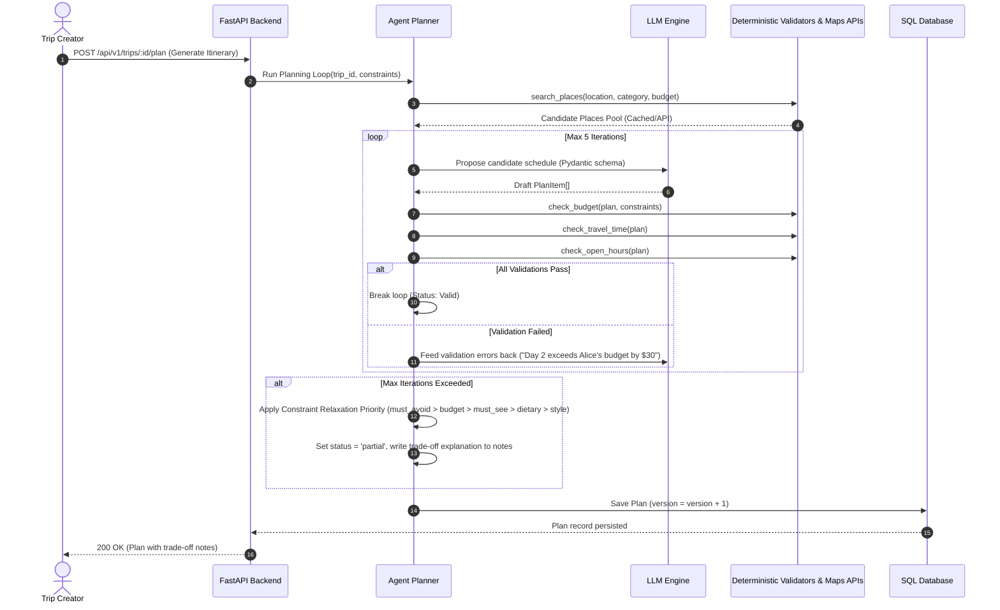

# System Architecture: Autonomous Travel & Group Itinerary Coordinator

## 1. System Overview

The **Autonomous Travel & Group Itinerary Coordinator** is an intelligent travel planning platform designed to solve group coordination friction. Rather than relying on a single generative LLM prompt, the system employs an **iterative agent loop** that proposes candidate plans, validates them using deterministic domain tools (budget math, travel times, operating hours), and self-corrects prior to presenting results to users.

### High-Level Architecture Diagram

```mermaid
graph TD
    UserClient[Frontend: React + Vite + Tailwind CSS]
    APIGateway[Backend API: FastAPI (Python 3.11+)]
    DB[(Database: SQLite Dev / PostgreSQL Prod)]
    AgentCore[Agent Planning Engine: Propose-Validate-Rebalance Loop]
    LLMService[LLM Provider: Claude 3.5 Sonnet / Gemini 1.5 Pro]
    GooglePlaces[Google Places API]
    GoogleDistance[Google Distance Matrix API]

    UserClient <-->|REST / JSON Contract (OpenAPI)| APIGateway
    APIGateway <-->|SQLModel / SQLAlchemy ORM| DB
    APIGateway <-->|Task Invocation| AgentCore
    AgentCore <-->|Structured Function Calling| LLMService
    AgentCore <-->|Venue Search & Details| GooglePlaces
    AgentCore <-->|Travel Time & Route Penalty| GoogleDistance
    AgentCore -->|Persist Plan Versions & Logs| DB
```

---

## 2. Major Components & Responsibilities

### 2.1 Frontend Client (`frontend/`)
- **Technology:** React 18+, Vite, TypeScript, Tailwind CSS, Lucide Icons, Leaflet / Google Maps JS SDK.
- **Responsibilities:**
  - Trip creation and shareable link management (`/trips/new`, `/trips/:tripId`).
  - Joiner constraint intake form (dates, budget per day, dietary preferences, pace/style tags, must-see/must-avoid).
  - Day-by-day interactive itinerary view with interactive map markers and route transitions.
  - Natural-language feedback input box ("Make day 2 more relaxed", "Swap lunch for seafood under $30").
  - "Simulate Disruption" button (e.g. flight delay, venue closure) to demonstrate real-time dynamic rebalancing.
  - Expense logger & settle-up balance breakdown.

### 2.2 Backend Service (`backend/`)
- **Technology:** Python 3.11+, FastAPI, SQLModel (Pydantic v2 + SQLAlchemy 2.0 core), Alembic migrations, Uvicorn.
- **Responsibilities:**
  - REST endpoints for Trip lifecycle, Constraints submission, Itinerary generation, and Expense tracking.
  - Execution runtime for the Agent Planning Loop and Dynamic Rebalancer.
  - Deterministic validation engine (`BudgetValidator`, `TravelTimeValidator`, `OpenHoursValidator`).
  - Third-party API caching layer (caching Places API and Distance Matrix responses in SQLite/PostgreSQL to minimize cost and latency).
  - Settle-up greedy debt-simplification calculation.

### 2.3 Shared Contract Package (`packages/shared/`)
- **Technology:** TypeScript type definitions (`types.ts`) and OpenAPI 3.1 specification (`openapi.yaml`).
- **Responsibilities:**
  - Defines the canonical domain models (`Trip`, `Constraint`, `Place`, `PlanItem`, `Plan`, `Expense`, `DisruptionEvent`).
  - Ensures type sync between frontend client queries and FastAPI response payloads.

### 2.4 External Services
- **Google Places API (New):** Query candidate attractions, restaurants, and venues matching category, location, and price tier.
- **Google Distance Matrix API:** Deterministic transit duration and distance lookups between consecutive plan stops to identify backtracking.
- **LLM Provider API:** Structured generation of initial drafts and candidate plan revisions based on tool feedback.

---

## 3. Data Flow & Agent Lifecycle

### 3.1 Trip & Constraint Collection
1. Trip creator posts to `/api/v1/trips` and receives `trip_id` and an invite URL.
2. Joiners load `/trips/:tripId`, enter a display name (session cookie/JWT generated without full OAuth), and submit constraints to `/api/v1/trips/:tripId/constraints`.
3. System aggregates group constraints (overlapping availability, average/minimum budget per day, dietary union).

### 3.2 Propose-Validate-Rebalance Loop



### 3.3 Dynamic Rebalancing Flow
When an unexpected disruption occurs (e.g., flight delay or closed museum):
1. Client sends `POST /api/v1/trips/:id/rebalance` with `DisruptionEvent`.
2. The agent isolates the **affected time window** (e.g. only Day 2 from 14:00 to 18:00), holding unaffected days and items fixed.
3. The propose-validate loop runs **strictly on the affected slice**, prioritizing minimum disruption to adjacent stops.
4. A new `Plan` version is persisted, allowing client UI to display side-by-side diffs.

---

## 4. Architectural Decisions & Rationales (ADRs)

| Decision | Choice | Why Key Choice Was Made (Rationale) |
|---|---|---|
| **Backend Framework** | FastAPI (Python) | High-performance async support, native Pydantic schema validation, and direct compatibility with LLM agent libraries, prompt harnesses, and deterministic numerical scoring scripts. |
| **Database & ORM** | SQLModel + Alembic | Bridges SQLAlchemy 2.0 with Pydantic v2. Enables sharing model definitions between API response serialization and database tables with zero duplication. |
| **Frontend Architecture** | React + Vite + Tailwind CSS | Fast bundle times, lightweight footprint, and broad ecosystem support for mapping components (Leaflet / Google Maps) and timeline drag-and-drop. |
| **Monorepo Structure** | Monorepo (`frontend/`, `backend/`, `packages/shared/`) | Keeps frontend client, backend service, agent evaluation scripts, and OpenAPI schemas synchronized in one repository without requiring private NPM registries or cross-repo PR coordination. |
| **Agent Architecture** | Deterministic Propose-Validate Loop vs Single-Shot LLM | Single-shot LLMs regularly hallucinate opening hours, underestimate transit backtracking, and miscalculate per-person split budgets. Validating against deterministic tools guarantees mathematical and schedule correctness. |
| **Storage Strategy** | Versioned Plan Persistence (`Plan.version`) | Storing every iteration/rebalance version rather than overwriting allows instantaneous before/after diffs in UI and provides an audit log for eval benchmarks. |
| **Settle-Up Algorithm** | Greedy Debt Cancellation | Minimizes transaction count efficiently ($O(N \log N)$ for $N \le 20$ participants) without requiring complex graph flow network libraries. |

---

## 5. Architectural Placeholders & Open Decisions

The following items are deferred or awaiting further validation in v2:

- `<!-- PLACEHOLDER: AUTH_PROVIDER -->`
  - *Current Status:* v1 uses local session tokens for joiners and lightweight creator authentication.
  - *Open Choice:* Evaluate Supabase Auth vs Clerk vs self-hosted JWT when user accounts with multi-trip dashboards are introduced.
- `<!-- PLACEHOLDER: REALTIME_SYNC_ENGINE -->`
  - *Current Status:* v1 uses polling / standard REST mutations.
  - *Open Choice:* Redis Pub/Sub + WebSockets vs Server-Sent Events (SSE) for multi-user live itinerary editing.
- `<!-- PLACEHOLDER: CALENDAR_EXPORT_PROVIDER -->`
  - *Current Status:* Read-only web share link + `.ics` iCalendar file download.
  - *Open Choice:* Google Calendar OAuth vs full CalDAV two-way synchronization.
- `<!-- PLACEHOLDER: LLM_GATEWAY_CACHE -->`
  - *Current Status:* Direct API calls with in-memory / SQLite API response caching.
  - *Open Choice:* Redis / LiteLLM proxy for semantic caching and token usage tracking.
